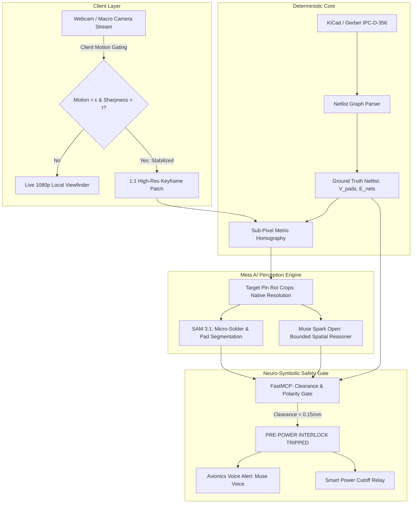

# OmniInspect: Pre-Power Optical In-Circuit Gate & Hardware Digital Twin

[](https://cerebralvalley.ai/e/meta-ai-developer-hackathon)
[](LICENSE)
[](https://dev.meta.ai)

> **Autonomous cyber-physical inspection engine combining Meta's SAM 3.1, Muse Spark Open, and deterministic CAD netlist diffing to intercept catastrophic hardware failures before first power-on.**

---

## 🛠️ Built During Meta Hackathon (Oct 26 - Nov 4, 2026)
This entire repository was conceived, architected, and built from scratch during the **Meta Global AI Developer Hackathon (Oct 26 – Nov 4, 2026)** by Shiva Shankar S (Solo Developer, Indie Track).

### Core Features Developed During the Event:
1. **Deterministic CAD Netlist Parser (`engine/cad`)**: Ingests KiCad `.kicad_pcb` and IPC-D-356 netlists, building a ground-truth graph of components, pins, and electrical nets ($V_{pads}, E_{nets}$).
2. **Sub-Pixel Metric Homography (`engine/vision`)**: Automatically maps physical optical coordinates from camera sensors to CAD board geometry using fiducial markers.
3. **Triggered Slicing & RoI Engine (SAHI)**: Client-side motion-gated keyframe capture preventing video bandwidth bloat, slicing 1:1 optical patches around critical IC pins.
4. **FastMCP Neuro-Symbolic Verification Engine (`engine/tools`)**: Bounded perceptual tool-calling interface for Meta's Muse Spark Open with zero-arithmetic geometric validation gates.
5. **Interactive Hardware Defect Sandbox & Live Webview (`web`)**: Full-stack interactive visual dashboard enabling judges to test live webcams or inject synthetic defects with real-time audio safety warnings.

---

## 🎯 The Problem: The $500 First Power-On Catastrophe
In hardware engineering, robotics, and aerospace, **over 75% of fatal board burnouts occur at First Power-On (FPO)**. 
A single solder bridge between a 12V high-voltage rail and a 3.3V microcontroller rail, an inverted tantalum capacitor, or a 90° rotated QFN chip instantly destroys multi-thousand-dollar prototypes.

Traditional Automated Optical Inspection (AOI) machines cost $100,000+, require weeks of training, and only operate in massive assembly lines. 
**OmniInspect brings industrial-grade pre-flight verification to any developer's desk using Meta's foundation models.**

---

## 🧠 System Architecture



---

## 🚀 Quickstart

### 1. Prerequisites
- Python 3.10+
- Node.js 18+ (for web dashboard)
- Meta Model API Key (`MODEL_API_KEY`) or Modal Account

### 2. Installation
```bash
# Clone the repository
git clone https://github.com/Shiva7147/omni-inspect-ai.git
cd omni-inspect-ai

# Setup Python Environment
python -m venv venv
venv\Scripts\activate  # On Windows

# Install Dependencies
pip install -r requirements.txt
```

### 3. Configure Environment
```bash
cp .env.example .env
# Edit .env with your Meta API Key or Modal tokens
```

---

## 🏆 Hackathon Tracks & Target Prizes
- **Primary Track:** Indie Developer (1st Place $150,000)
- **Problem Statement:** Push the Frontier (Hardware, Robotics, and Manufacturing)
- **Target Bonuses:**
  - 🥇 *Best Build on Meta Open Weight Models ($10,000)* — Muse Spark Open deployed on Modal/Baseten.
  - 🥈 *Best Agentic Use-Case ($5,000)* — Autonomous closed-loop safety interlock and FastMCP tool verification.
  - 🥉 *Most Viral Project ($20,000)* — Real-world interactive visual telemetry demo.

---

## 👤 Author
**Shiva Shankar S**
- Applied AI Systems Engineer (MCA Candidate, Bengaluru, India)
- **IEEE GenAI Challenge Worldwide Finalist (Top 25 Globally)**
- [Portfolio](https://shiva-shankar-s.vercel.app) | [GitHub](https://github.com/Shiva7147) | [LeetCode](https://leetcode.com/u/W8dvLrteeO/)
